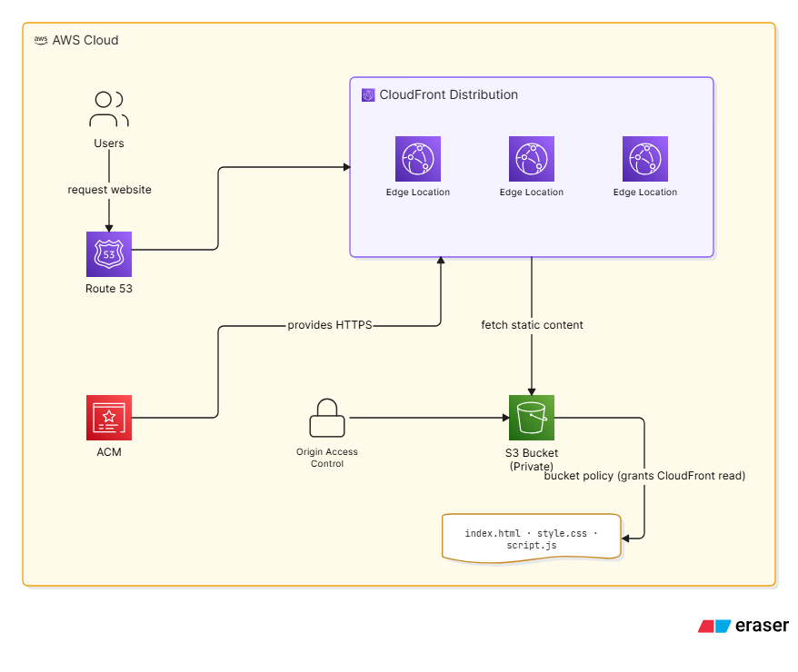

# Static Website Hosting: S3 + CloudFront (Terraform)

## Overview
Production-pattern static site hosting on AWS: a private S3 bucket serves content exclusively through CloudFront, with public bucket access fully blocked and access restricted to CloudFront via Origin Access Control (OAC). Provisioned entirely with Terraform.

## What This Solves

Hosting a static site on AWS looks simple, but the quickest way to do it is also the least safe and the slowest for users:

- **Public buckets are a leading cause of data leaks.** The common tutorial approach is to make the bucket public and turn on S3 website hosting. Every object becomes readable by anyone with the URL, and one wrong policy edit later can expose files that were never meant to be shared.
- **No HTTPS on S3 website endpoints.** S3's website endpoint serves HTTP only. Browsers mark the site "Not secure", and modern features that need a secure context won't work.
- **Slow for distant users.** A bucket lives in one region. A visitor on another continent fetches every file across the world on every request.
- **Every request hits the bucket.** Without a cache in front, all traffic goes straight to S3, which costs more and gives no protection against traffic spikes.
- **Manual uploads drift.** Uploading files by hand through the console makes it easy to forget a file, set the wrong content type (so CSS or JS doesn't load), or lose track of what's deployed.

This project keeps the bucket fully private, serves the site over HTTPS from CloudFront's global edge network with caching, and manages both the infrastructure and the site files in Terraform, so a single `terraform apply` deploys everything with correct content types.

## Architecture



> **Note:** The diagram includes Route 53 and ACM for a custom domain + managed HTTPS certificate. The current deployment uses CloudFront's default certificate (`*.cloudfront.net`) — no custom domain is attached yet. See [Next Steps](#next-steps) for the plan to close that gap.

### Request flow (as currently deployed)
```
User -> CloudFront (HTTPS, default cert) -> S3 Bucket (private, OAC-restricted)
```

### Why the bucket is private
The S3 bucket has all public access blocked (`block_public_acls`, `block_public_policy`, `ignore_public_acls`, `restrict_public_buckets` all `true`). The only way to reach the objects is through CloudFront, which authenticates to S3 using Origin Access Control — a signed request CloudFront generates per-request. The bucket policy grants `s3:GetObject` exclusively to the CloudFront service principal, scoped to this specific distribution's ARN via a `Condition` block. This means:
- No direct S3 URL for any file ever works
- No accidental public bucket exposure
- Only traffic passing through this exact CloudFront distribution can read objects

## Components

| Resource | Purpose |
|---|---|
| `aws_s3_bucket` | Stores site files (`index.html`, `style.css`, `script.js`) |
| `aws_s3_bucket_public_access_block` | Blocks all public access at the bucket level |
| `aws_cloudfront_origin_access_control` | Lets CloudFront sign requests to the private bucket |
| `aws_s3_bucket_policy` | Grants read access to CloudFront only, scoped by distribution ARN |
| `aws_s3_object` (xN, via `for_each`) | Uploads every file under `www/`, with correct `content_type` per extension |
| `aws_cloudfront_distribution` | Global CDN, HTTPS enforced, `index.html` as default root object |

## Prerequisites

- AWS CLI configured with a named profile
- Terraform >= 1.0
- Site files present under `www/` (`index.html`, `style.css`, `script.js`)

## Deployment

```bash
terraform init
terraform plan
terraform apply
```

Terraform will output the CloudFront domain once complete. First-time deploys take 5-15 minutes for the distribution to fully propagate before it's reachable — a fresh distribution returning `AccessDenied` or a timeout in that window is expected, not a bug.

## Updating Site Content

Any file added, removed, or changed under `www/` is picked up automatically by the `for_each` on `fileset()` — re-run `terraform apply` after editing site files. Note: CloudFront caches responses (`default_ttl = 3600`), so a content change may not appear immediately without a cache invalidation:

```bash
aws cloudfront create-invalidation --distribution-id <ID> --paths "/*"
```

## Design Decisions

**Why CloudFront in front of S3 instead of S3 website hosting alone:**
S3's website endpoint serves HTTP only and requires the bucket to be public. CloudFront provides HTTPS, caches content at edge locations close to users, and absorbs traffic so most requests never reach the bucket. It also lets the bucket stay completely private, which S3 website hosting cannot do.

**Why Origin Access Control instead of Origin Access Identity:**
OAI is AWS's legacy mechanism for letting CloudFront read a private bucket. OAC is its replacement and the one AWS recommends for new distributions: it signs every request with SigV4, works in all regions, and supports buckets encrypted with SSE-KMS, which OAI does not. Starting on OAC avoids a migration later.

**Why the S3 REST endpoint as the origin, not the website endpoint:**
OAC only works with the bucket's REST endpoint. The website endpoint is treated as a custom HTTP origin, which CloudFront can't sign requests to, so using it would force the bucket to be public again. The trade-off is that S3 website features such as automatic `index.html` in subfolders aren't available; `default_root_object` covers the site root, which is all this site needs.

**Why the bucket policy is scoped to one distribution's ARN:**
Granting `s3:GetObject` to the CloudFront service principal alone would let *any* CloudFront distribution, including one in another AWS account, read the bucket. The `AWS:SourceArn` condition limits access to this distribution only, closing what is known as the confused-deputy problem.

**Why all four public access block settings are enabled:**
The bucket policy already restricts access, but the public access block is a second, independent guard. Even if someone later attaches a public ACL or a policy granting `*`, S3 rejects or ignores it. Defence in depth costs nothing here.

**Why site files are uploaded with Terraform instead of `aws s3 sync`:**
With `for_each` over `fileset()`, every file under `www/` becomes a tracked resource. Added files are uploaded, removed files are deleted from the bucket, and changed files are detected through their `etag` (an MD5 of the file). Infrastructure and content deploy in one step, with no separate script to forget. For a large site with thousands of files, a sync step in CI would scale better; at this size, one tool is simpler.

**Why `content_type` is set per file extension:**
S3 doesn't infer content types reliably for uploaded objects. Without the correct type, browsers may download a CSS file instead of applying it, or refuse to run JavaScript served as `binary/octet-stream`. Mapping each extension to its MIME type guarantees the site renders correctly.

**Why a one-hour default TTL:**
`default_ttl = 3600` balances freshness against cache hit rate. Most requests are served from the edge, keeping latency low and S3 requests few, while an unchanged deploy still shows up within an hour without intervention. When a change must appear immediately, an invalidation clears the cache.

**Why CloudFront's default certificate for now:**
The `*.cloudfront.net` certificate gives full HTTPS with no domain purchase, DNS setup, or certificate validation. It proves the architecture end to end; a custom domain with ACM and Route 53 is an additive change on the same distribution, covered in Next Steps.

## Issues Hit and Fixed During Build

**1. Hardcoded placeholder bucket reference**
Policy and origin blocks referenced `aws_s3_bucket.example` — a leftover from the tutorial this was adapted from. The actual resource is named `firstbucket`. Fixed all references to match the real resource name.

**2. Wrong IAM principal type in bucket policy**
Policy granted access via `"Principal": {"AWS": "cloudfront.amazonaws.com"}`. `AWS`-type principals are for account/IAM ARNs; a service principal requires `"Service": "cloudfront.amazonaws.com"`. Left uncorrected, CloudFront would never have been authorized to read the bucket regardless of any other configuration.

**3. Invalid IAM JSON casing**
Policy used lowercase `condition` / `stringEquals`, which AWS's policy parser doesn't recognize — it silently rejected the whole policy at `apply` time with `MalformedPolicy: Unknown field condition`. IAM/S3 policy keys are case-sensitive: `Condition`, `StringEquals`.

**4. Broken file path syntax in `aws_s3_object`**
`source` and `etag` used `"${path.module}/www}/${each.value}"` — a stray `}` mid-string. This surfaced late, only once earlier bugs were fixed, as a `filemd5: file not found` error during apply. Corrected the interpolation syntax.

**5. Unused ACM data source lookups**
`data.tf` contained `aws_acm_certificate` data sources querying for a certificate that was never requested, since this deployment uses CloudFront's default certificate rather than a custom domain. These failed with `empty result` on every plan. Removed, since there's nothing for them to look up in the current architecture.

## Known Limitations

- No custom domain — served only via the CloudFront-assigned `*.cloudfront.net` URL
- No cache invalidation automation — manual `aws cloudfront create-invalidation` required after content updates
- No CI/CD — deploys are manual (`terraform apply`)

## Next Steps

- Attach a custom domain via Route 53 + ACM (cert must be requested in `us-east-1` for CloudFront)
- Automate deploys with GitHub Actions (`terraform apply` on push to `main`, plus automatic cache invalidation)
- Add a custom error page (404) instead of CloudFront's default error response

## Cleanup

```bash
terraform destroy
```

Removes the S3 bucket, all objects, the bucket policy, OAC, and the CloudFront distribution.
